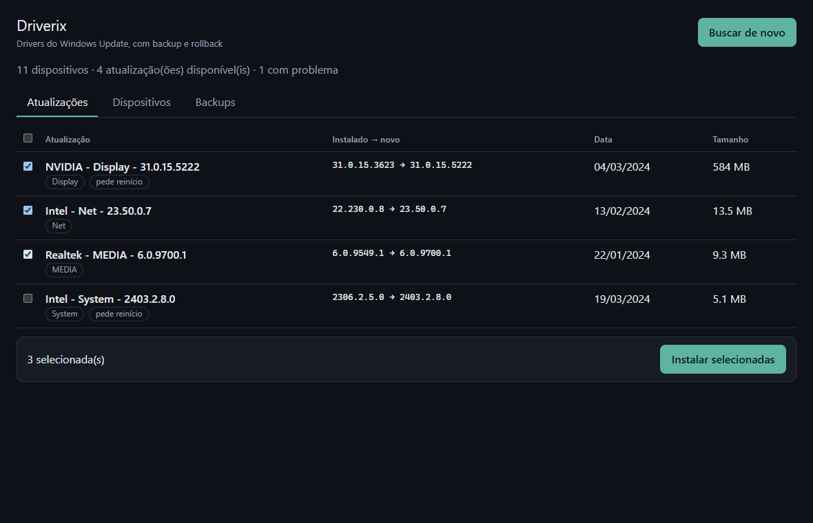
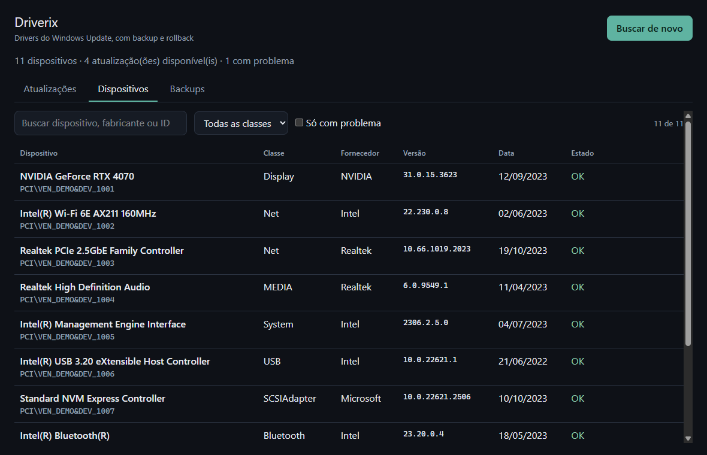
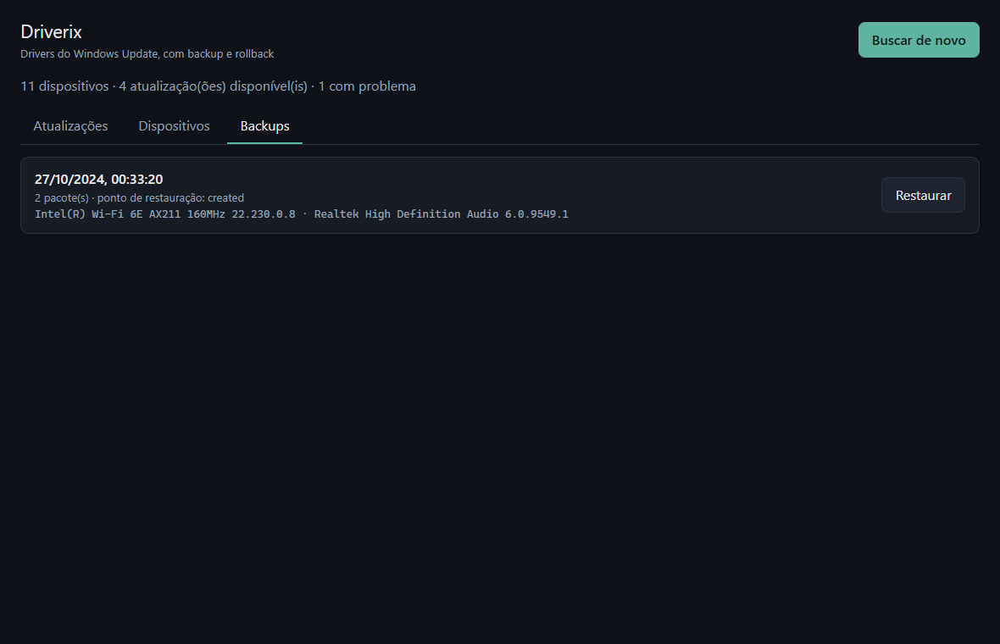
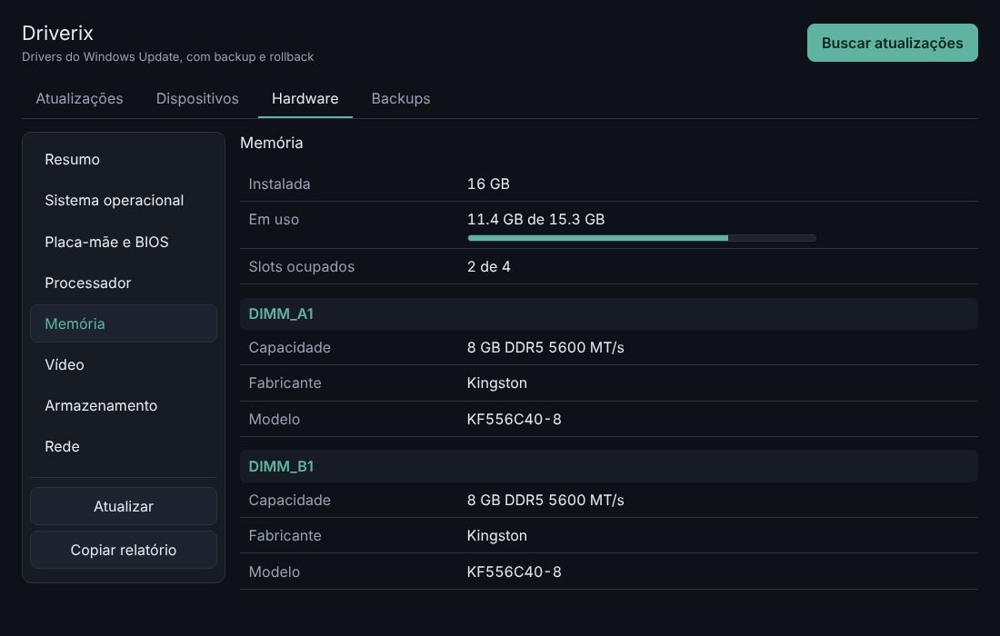

<div align="center">


# driverix

**Encontre drivers desatualizados, instale com rede de segurança e volte atrás com um clique.**

Detecta o hardware do Windows e atualiza os drivers pelo Windows Update, com ponto de restauração, backup do driver atual e rollback. Sem paywall, sem instalador embutido, sem telemetria.

[](https://github.com/juninmd/driverix/actions/workflows/ci.yml)
[](LICENSE)


[](https://www.conventionalcommits.org/pt-br/)



<sub>Capturas com dados de demonstração (<code>scripts/demo-mock.js</code>): nenhum dispositivo real aparece nelas.</sub>

</div>

---

> [!WARNING]
> Instalar e restaurar foram validados com testes automatizados contra um `Host` falso, **ainda não numa máquina real com admin**. Busca e inventário foram testados de verdade. Faça o ciclo completo numa VM ou crie seu próprio ponto de restauração antes de confiar. Detalhes em [Limites conhecidos](#-limites-conhecidos).

## ✨ O que ele faz

| | |
|---|---|
| 🔍 **Inventário** | Lê todos os dispositivos PnP (`Win32_PnPEntity` + `Win32_PnPSignedDriver`): classe, fabricante, versão, data, INF, assinatura e código de problema do Gerenciador de Dispositivos. |
| 🖥️ **Hardware (estilo AIDA64)** | Aba com árvore de categorias e lista de propriedades: computador, SO, placa-mãe e BIOS, CPU (núcleos, clock, caches), memória (módulos, tipo, velocidade, uso), vídeo (VRAM real, driver), discos (tipo, saúde, uso por volume), rede e bateria. Botão para copiar o relatório em texto. Somente leitura. |
| 🏷️ **Base de IDs** | Decodifica `VEN_`/`VID_` dos hardware IDs offline (fabricante e classe PCI), então um dispositivo sem nome ainda aparece como `PCI 10DE:2684 · Controlador de vídeo`. Drivers de terceiros com 3+ anos ganham o selo "antigo". |
| ⬆️ **Atualizações** | Pergunta ao Windows Update por drivers (`Type='Driver'`) e casa cada oferta com o dispositivo pelo hardware ID. A comparação é numérica (`10.9` < `10.10`) e **nunca faz downgrade**. |
| 🛟 **Instalação segura** | Ponto de restauração → exporta o pacote atual (`pnputil /export-driver`) → instala → confere se o dispositivo ficou sem erro. Se qualquer passo antes da instalação falhar, nada é instalado. |
| ⏪ **Rollback** | A aba Backups reinstala o pacote anterior e só conta como restaurado se o dispositivo voltar a reportar a versão antiga. |
| 🧩 **Dispositivo sem driver** | Se o Gerenciador de Dispositivos reporta problema 28 (driver não instalado), o app oferece o driver compatível. Sem esse sinal, não adivinha. |
| 🔒 **Confiança mínima na interface** | A interface só envia IDs. O backend revalida cada um contra a última busca (formato, presença, decisão `Newer`, admin, no máximo 25 por lote). |

## 📸 Telas

<table>
  <tr>
    <td></td>
    <td></td>
  </tr>
  <tr>
    <td colspan="2"></td>
  </tr>
  <tr>
    <td colspan="2" align="center"><sub>Hardware: visão de máquina no estilo AIDA64</sub></td>
  </tr>
  <tr>
    <td align="center"><sub>Dispositivos: tudo o que o Windows enxerga</sub></td>
    <td align="center"><sub>Backups: um clique para voltar</sub></td>
  </tr>
</table>

## 🆚 Por que não usar Driver Easy, CCleaner ou Driver Booster?

Eles fazem o mesmo trabalho base (inventariar, achar versão mais nova, instalar). O Driverix faz com as regras opostas:

| | Típico de updaters comerciais | Driverix |
|---|---|---|
| Instalar | atrás de plano pago | sempre grátis |
| Origem | mirrors e binários próprios | só Windows Update, assinado pela Microsoft |
| Casamento | por nome ou texto, instável | por hardware ID e versão numérica |
| Voltar atrás | pouco ou nenhum | restauração + backup do pacote anterior |
| Telemetria / extras | frequentes | nenhuma |
| EULA | aceito por você | nunca aceito automaticamente |

> Nenhum binário proprietário foi baixado, executado ou decompilado: as EULAs proíbem, e a pesquisa usou só fontes públicas e APIs documentadas do Windows. O que foi e o que não foi confirmado está em [`docs/RESEARCH.md`](docs/RESEARCH.md).

## 🚀 Uso

Requer [Bun](https://bun.sh), [Rust](https://rustup.rs) e Windows 10 1607+ ou 11.

```bash
bun install
bun tauri dev        # instalar e restaurar exigem terminal elevado
```

Buscar não exige admin. Instalar e restaurar exigem; o app oferece **Reabrir como administrador**.

CLI somente leitura, boa para diagnóstico (nunca instala nada):

```bash
cargo run --manifest-path src-tauri/Cargo.toml --bin driverix-cli -- devices        # inventário
cargo run --manifest-path src-tauri/Cargo.toml --bin driverix-cli -- hardware       # relatório de hardware (--json para dados)
cargo run --manifest-path src-tauri/Cargo.toml --bin driverix-cli -- scan --json    # ofertas
```

## ⚠️ Limites conhecidos

- **Cobertura = o que a Microsoft publica.** Drivers de GPU lançados ontem pela NVIDIA, AMD ou Intel podem ainda não estar no Windows Update. Fontes de fabricante ficaram de fora de propósito: os endpoints são não documentados ou com termos que restringem automação.
- **Instalar e restaurar não rodaram numa máquina real elevada.** Ordem das etapas, abortos e manifestos estão cobertos por testes com `Host` falso; `icacls`, `pnputil` e a instalação via Windows Update, não.
- **A aba Hardware ainda não rodou numa máquina Windows real:** o parser e a formatação têm testes, o script de coleta (`hardware.ps1`) não. `driverix-cli hardware` ajuda a conferir.
- Só Windows 10 1607+ e 11 (usa `pnputil /export-driver`). Drivers inbox (que não são `oem*.inf`) não são exportáveis; para eles, o ponto de restauração é o caminho de volta.

## 🗺️ Roadmap

1. Ciclo instalar → verificar → restaurar testado numa VM, e um e2e que o automatize.
2. Fonte opcional: Microsoft Update Catalog, depois de confirmar os termos de uso.
3. Atualização automática do app (updater assinado) e pipeline de release.

## 🛠️ Desenvolvimento

Veja [`AGENTS.md`](AGENTS.md) para comandos, layout e invariantes de segurança. [`SECURITY.md`](SECURITY.md) descreve o modelo de ameaças e como reportar uma falha. Gates:

```bash
bun run lint && bun run typecheck && bun run test
cd src-tauri && cargo fmt --check && cargo clippy --all-targets -- -D warnings && cargo test
```

Para refazer as capturas: `bun run dev` e injete `scripts/demo-mock.js` antes de a página carregar.

## 📄 Licença

[MIT](LICENSE)
